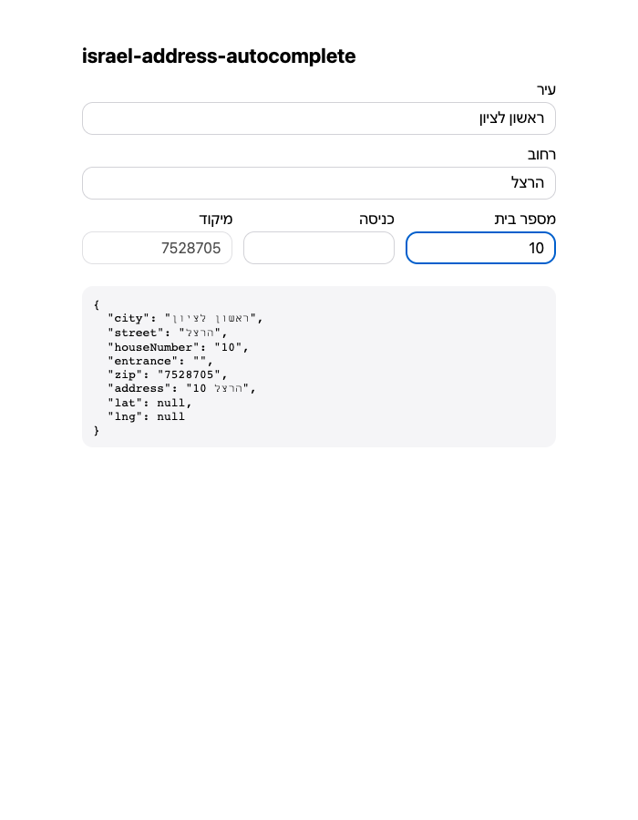

# israel-address-autocomplete

**Israeli address input the way Israel Post does it: city → street → house number, with the zip code filled in automatically.**

[](https://github.com/mikey641/israel-address-autocomplete/actions/workflows/ci.yml)
[](LICENSE)


Free-text address fields collect typos, made-up spellings and "ת״א" vs "תל אביב-יפו". This package
works like [doar.israelpost.co.il/locatezip](https://doar.israelpost.co.il/locatezip): the user
first picks a city from the official settlements registry, then a street that really exists in
that city. The house number and entrance are typed, and the 7-digit zip (מיקוד) fills in by
itself. Coordinates come from [GovMap](https://www.govmap.gov.il) when it can be reached.

<p align="center"></p>

What's in the package:

| Layer | Import | Runs on |
| --- | --- | --- |
| **Lookup client**: `searchCities`, `searchStreets`, `lookupZip`, `geocode` | `israel-address-autocomplete` | Server (Node ≥ 20, Workers, Bun, Deno) |
| **Proxy handler**: `createAddressHandler()` → `(Request) => Response` | `israel-address-autocomplete` | Any fetch-standard runtime |
| **React component**: `<AddressAutocomplete />` | `israel-address-autocomplete/react` | Browser (React ≥ 18) |

There are no runtime dependencies. React is an optional peer dependency.

> **Why a proxy?** The Israel Post API sends no CORS headers, so a browser cannot call it
> directly. Mount `createAddressHandler()` on your own origin. It is one line in most frameworks.

## Install

```sh
npm install israel-address-autocomplete
```

## Quick start (Next.js App Router)

```ts
// app/api/address/route.ts
import { createAddressHandler } from "israel-address-autocomplete";

export const GET = createAddressHandler();
```

```tsx
// any page or form
import { AddressAutocomplete } from "israel-address-autocomplete/react";

<form action={save}>
  <AddressAutocomplete onChange={(v) => console.log(v)} />
  <button>Save</button>
</form>
```

Inside a `<form>`, hidden inputs submit `city`, `street`, `house_number`, `entrance`, `zip`,
`address` ("הרצל 10 כניסה א"), and `latitude` / `longitude` when known. See
[`examples/nextjs`](examples/nextjs) for a Tailwind-styled version.

## Server-side lookups

```ts
import { searchCities, searchStreets, lookupZip, geocode } from "israel-address-autocomplete";

await searchCities("ראשון");
// [{ id: "1252", symbol: "8300", name: "ראשון לציון", synonym: 'ראשל"צ' }]

await searchStreets("ראשון לציון", "הרצ");
// [{ id: "89149", symbol: "0307", name: "הרצל", synonym: "הרצל אז תעש", cityId: "1252" }, …]

await lookupZip({ city: "ראשון לציון", street: "הרצל", house: "10", entrance: "א" });
// "7528705"   (falls back to the street-level zip if the house is not in the zip database)

await geocode("הרצל 10 ראשון לציון");
// [{ label, address: "הרצל 10", street, houseNumber, city, lat, lng }]
```

Things to know:

- Searches match on **prefix** and also on the registry **synonym**, so "קש" finds "הקשת".
- `symbol` is the CBS code (סמל יישוב / סמל רחוב), which is useful for joining with government datasets.
- `searchStreets` and `lookupZip` take a city name, a registry city id, or a `City` object. A
  city name costs one extra lookup to resolve its id.
- None of these functions throw on network or upstream errors. They return `[]` or `null`, so
  autocomplete degrades instead of crashing the form.

All functions accept options:

```ts
{
  fetch?: typeof fetch;        // custom fetch (caching, logging, tests)
  signal?: AbortSignal;
  baseUrl?: string;            // Israel Post only: proxy or mock base URL
  subscriptionKey?: string;    // Israel Post only: defaults to the public doar.israelpost.co.il key
  init?: RequestInit;          // Israel Post only: merged into every request, e.g. { next: { revalidate: 86400 } }
}
```

## The HTTP handler

`createAddressHandler(options?)` returns a `(Request) => Promise<Response>` that serves:

| Request | Response |
| --- | --- |
| `GET ?type=cities&q=ראשון` | `{ "results": ["ראשון לציון"] }` |
| `GET ?type=streets&city=ראשון לציון&q=הרצ` | `{ "results": ["דרך חיים הרצוג", "הרב הרצוג", "הרץ גוסטב", "הרצל"] }` |
| `GET ?type=zip&city=…&street=…&house=10&entrance=א` | `{ "zip": "7528705" }` |
| `GET ?type=geocode&q=הרצל 10 ראשון לציון` | `{ "results": [{ "label", "address", "city", "lat", "lng", … }] }` |

Options: `israelPost`, `govmap` (client options as above), `streetLimit` (default 10),
`cacheControl` (default `public, max-age=3600, s-maxage=86400`), and `allowOrigin` (sends CORS
headers when the UI is served from a different origin).

It runs as-is in other runtimes:

```ts
export default { fetch: createAddressHandler() };          // Cloudflare Workers / Bun
Deno.serve(createAddressHandler());                         // Deno
app.get("/api/address", (c) => handler(c.req.raw));         // Hono
```

For Express or plain `node:http`, adapt it to a `Request` the way
[`examples/demo/server.ts`](examples/demo/server.ts) does.

## The React component

```tsx
<AddressAutocomplete
  endpoint="/api/address"                 // where createAddressHandler is mounted
  defaultValue={{ city, street, houseNumber, entrance, zip }}  // or { address: "הרצל 12" } for legacy rows
  onChange={(value: AddressValue) => {}}  // fires whenever any part changes
  names={{ houseNumber: "house_no" }}     // rename hidden inputs, or `false` for none
  labels={{ city: "City", street: "Street" /* … */ }}  // Hebrew by default
  classNames={{ root, field, label, input, menu, option, optionActive, row }}
  dir="rtl"
  debounceMs={250}
  disableGeocode={false}
  disabled={false}
/>
```

- Uses the WAI-ARIA combobox pattern with Arrow keys, Enter and Escape. The menu opens only
  after the user types, never when an existing value loads.
- Changing the city clears the street and number. The street field stays disabled until a city
  is chosen.
- The zip is derived, not typed. Saved values are kept until the user edits the address, then
  the zip is fetched again, so a stale zip is never submitted.
- `autocomplete="one-time-code"` stops Chrome's saved-address autofill from covering the menu.
- It is unstyled apart from minimal inline defaults. Any `classNames` key you pass replaces
  the inline style for that element.
- The module carries `"use client"`, so you can import it straight into App Router server components.

## Run the demo

```sh
git clone https://github.com/mikey641/israel-address-autocomplete.git
cd israel-address-autocomplete
npm install
npm run demo        # http://localhost:5173
```

## Data sources and caveats

- **Israel Post** (`apimftprd.israelpost.co.il/mypost-zip`) is the API behind the official
  zip-code finder. The default subscription key is the public one shipped in that site's
  JavaScript bundle. It is not a secret, but it belongs to Israel Post and could be rotated. If
  that happens, pass the new key through `subscriptionKey`. Be a good citizen: debounce input
  (the component does) and cache responses (the handler sets `Cache-Control`).
- **GovMap** (`govmap.gov.il/api/search-service/autocomplete`) is used only for coordinates. Its
  CloudFront front blocks many datacenter and some residential IP ranges. When it does,
  `geocode()` returns `[]` and `lat` / `lng` stay `null`.
- This project is not affiliated with Israel Post or the Survey of Israel. Check that your use
  fits their terms.

## Development

```sh
npm test            # offline unit tests (mocked fetch)
npm run test:live   # hits the real Israel Post API
npm run typecheck
npm run build
```

## License

[MIT](LICENSE) © Michael Hasson
